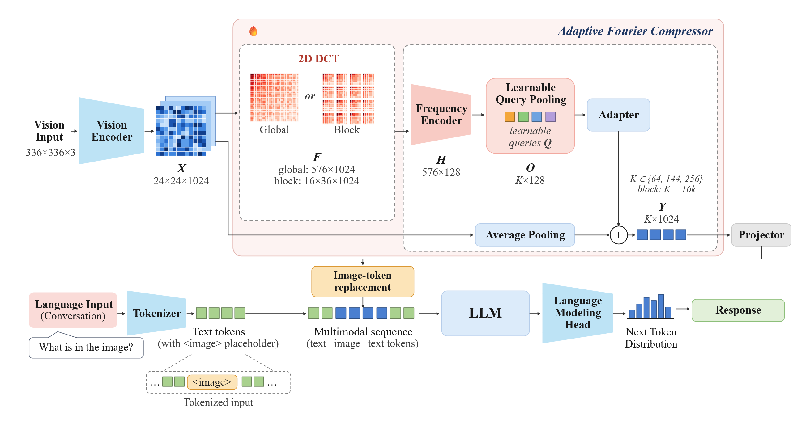

<div align="center">
<h1>AFC</h1>
<h3>Visual Token Compression for Vision-Language Models via Adaptive Frequency Aggregation</h3>

Jin Ryu<sup>†</sup>, Gyuwan Choi<sup>†</sup>, Yeejin Lee<sup>:email:</sup>

Seoul National University of Science and Technology

(<sup>†</sup>) equal contribution, (<sup>:email:</sup>) corresponding author

[](LICENSE)&nbsp;
[](https://huggingface.co/liuhaotian/llava-v1.5-7b)&nbsp;

</div>

## News
* **`Oct. 2026`:** We release the code of AFC (Adaptive Fourier Compressor) with training / evaluation scripts and the compared baselines.

## Table of Contents
- [Introduction](#introduction)
- [Method](#method)
- [Results](#results)
- [Getting Started](#getting-started)
- [Code Structure](#code-structure)
- [Contact](#contact)
- [Acknowledgement](#acknowledgement)
- [Citation](#citation)

## Introduction
Vision-language models (VLMs) incur substantial computational and memory costs due to large numbers of visual tokens. We propose the **Adaptive Fourier Compressor (AFC)**, which applies the discrete cosine transform (DCT) to visual features and adaptively compresses frequency components through learnable query pooling. AFC is trained via knowledge distillation while keeping the pretrained VLM frozen. On six benchmarks using LLaVA-1.5-7B, AFC achieves the highest average performance among evaluated compression methods at 64, 144, and 256 tokens. With 64 tokens, AFC retains **94.1%** of the original performance, outperforming a directly evaluated low-frequency truncation baseline by **5.0 percentage points**.

**Keywords:** VLM, compressor, frequency, DCT, learnable query pooling

<div align="center">

<br>
<b>Overall architecture of a vision-language model with the Adaptive Fourier Compressor (AFC).</b>
</div>

## Method

AFC is inserted between the vision encoder and the multimodal projector. It keeps the output channel dimension ($C = 1024$), so the frozen projector and language model are used without any structural change.

**DCT.** The patch tokens $V \in \mathbb{R}^{576 \times 1024}$ are reshaped into a feature map $X \in \mathbb{R}^{24 \times 24 \times 1024}$, and a 2D DCT with the orthonormal matrix $D \in \mathbb{R}^{N \times N}$ is applied to every channel $X^{(c)}$:

$$F^{(c)} = D X^{(c)} D^{\top}, \qquad D_{u,i} = \alpha_u \cos\frac{\pi(2i+1)u}{2N}, \qquad \alpha_0 = \sqrt{1/N},\ \alpha_u = \sqrt{2/N}\ (u>0).$$

The coefficients of all channels at the same frequency $(u,v)$ form a frequency token $f_{u,v} \in \mathbb{R}^{1024}$.

| Variant | DCT | Frequency tokens |
| :--- | :--- | :---: |
| **AFC-global** | whole feature map, $N = 24$ | $576 \times 1024$ |
| **AFC-block** | 16 non-overlapping $6 \times 6$ blocks, $N = 6$ | $16 \times 36 \times 1024$ |

**Frequency encoder.** Each token passes LayerNorm and a linear projection, and a frequency position embedding is added (AFC-block also adds a block position embedding $b_j \in \mathbb{R}^{128}$):

$$z_{u,v} = \mathrm{LN}(f_{u,v})\,W_{in} + e_{u,v}\ (+\,b_j).$$

A 2-layer Transformer encoder gives $H = [h_1, \dots, h_{576}] \in \mathbb{R}^{576 \times 128}$ (AFC-block: applied to the 36 tokens of each block with shared parameters).

**Learnable query pooling.** Unlike Fourier-VLM, which keeps a fixed low-frequency band, AFC aggregates frequency components with cross-attention from learnable queries $Q = [q_1, \dots, q_K] \in \mathbb{R}^{K \times 128}$ (4 heads, $d_h = 32$, LN on queries and keys/values):

$$o_i^{(r)} = \sum_{m=1}^{M} \mathrm{softmax}_m\!\left(\frac{(q_i W_Q^{(r)})(h_m W_K^{(r)})^{\top}}{\sqrt{d_h}}\right) h_m W_V^{(r)}, \qquad o_i = \left[o_i^{(1)}, \dots, o_i^{(4)}\right] W_O.$$

AFC-global uses $K$ queries over all tokens; AFC-block shares $k$ queries over the 16 blocks, giving $K = 16k$ tokens.

**Residual output.** A 2-layer MLP adapter (LN, GELU, $128 \rightarrow 512 \rightarrow 1024$) maps the pooled tokens back to the CLIP width and adds them to adaptive average pooling of $X$:

$$Y = \mathrm{AvgPool}(X) + \mathrm{Adapter}(O).$$

The last adapter layer is zero-initialized, so training starts exactly from average pooling.

**Training.** The vision encoder, projector, and language model are frozen. The teacher is the same model with the original 576 tokens (no gradient), and only the compressor is optimized with cross-entropy and knowledge distillation over the answer-token positions $\mathcal{A}$ ($\lambda = 1$, $T = 2$):

$$\mathcal{L} = \mathcal{L}_{CE} + \lambda \frac{T^2}{|\mathcal{A}|} \sum_{t \in \mathcal{A}} D_{KL}\!\left(p_{tea,t}^{(T)} \,\|\, p_{stu,t}^{(T)}\right).$$

## Results

### Benchmark performance

> Frozen LLaVA-1.5-7B; every row is measured by us under the same setting. Fourier-VLM is its low-frequency truncation applied to the same frozen model; PruMerge uses the official implementation without training and with a fixed token budget.

| Model | #I | GQA | SciQA | VQA<sup>T</sup> | POPE | MMB | MMMU | Avg. |
| :--- | :---: | :---: | :---: | :---: | :---: | :---: | :---: | :---: |
| LLaVA-1.5-7B | 576 | 61.9 | 69.6 | 58.2 | 85.9 | 64.3 | 36.7 | 62.8 |
| ***Token reduction ratio: 55.6%*** | | | | | | | | |
| Avg pooling | 256 | 58.3 | 68.0 | 51.8 | 81.7 | 59.4 | **35.7** | 59.1 |
| Fourier-VLM | 256 | 59.6 | **68.8** | 53.4 | 84.1 | 61.6 | 35.3 | 60.5 |
| PruMerge | 256 | 58.6 | 68.3 | **55.2** | **85.1** | 62.8 | 34.7 | 60.8 |
| AFC-block (ours) | 256 | **60.2** | **68.8** | 53.8 | 83.6 | **63.6** | 35.4 | **60.9** |
| AFC-global (ours) | 256 | 60.1 | 68.5 | 54.0 | 83.2 | 63.0 | 35.1 | 60.7 |
| ***Token reduction ratio: 75.0%*** | | | | | | | | |
| Avg pooling | 144 | 57.2 | 67.6 | 49.7 | 81.2 | 56.2 | 35.7 | 57.9 |
| Fourier-VLM | 144 | 56.9 | 69.3 | 50.1 | 81.7 | 58.2 | 36.3 | 58.8 |
| PruMerge | 144 | 57.0 | 69.0 | **55.2** | 81.7 | 61.5 | **36.9** | 60.2 |
| AFC-block (ours) | 144 | 59.8 | 68.4 | 52.7 | 81.9 | **62.6** | 36.3 | 60.3 |
| AFC-global (ours) | 144 | **60.1** | **69.4** | 52.7 | **83.2** | 61.9 | 36.4 | **60.6** |
| ***Token reduction ratio: 88.9%*** | | | | | | | | |
| Avg pooling | 64 | 53.1 | 65.9 | 45.3 | 74.4 | 46.3 | 33.2 | 53.0 |
| Fourier-VLM | 64 | 54.0 | 66.7 | 46.0 | 74.0 | 50.3 | 33.9 | 54.1 |
| PruMerge | 64 | 54.4 | **68.8** | **54.5** | 73.1 | 59.4 | **35.9** | 57.7 |
| AFC-block (ours) | 64 | 57.9 | 67.6 | 50.2 | 81.7 | **60.7** | 35.4 | 58.9 |
| AFC-global (ours) | 64 | **58.3** | 68.5 | 49.4 | **82.5** | 60.2 | 35.6 | **59.1** |

### Computational cost

> Theoretical values for Vicuna-7B (FP16, 64 text tokens assumed). KV cache per token $= 2 L d_{LLM} b = 0.5$ MiB; prefill $\approx 2Pn + 2 L d_{LLM} n^2$ ($P = 6.48$B without embeddings, $n$: input tokens). AFC FLOPs are measured on the trained configuration (`scripts/afc/complexity.py`).

| #I | KV cache (MiB) | Prefill (TFLOPs) | Prefill red. | AFC-global (GFLOPs) | AFC-block (GFLOPs) |
| :---: | :---: | :---: | :---: | :---: | :---: |
| 576 | 288 | 8.40 | – | – | – |
| 256 | 128 | 4.17 | 50.3% | 0.64 | 0.52 |
| 144 | 72 | 2.71 | 67.8% | 0.47 | 0.38 |
| 64 | 32 | 1.66 | 80.2% | 0.34 | 0.28 |

The compressor costs less than 0.02% of the prefill computation it saves (4.2–6.7 TFLOPs); actual latency depends on the implementation.

## Getting Started

### 1. Environment
```bash
git clone https://github.com/gyuz1/AFC.git
cd AFC
bash scripts/afc/setup_env.sh        # conda env `afc` (transformers 4.37.2, lmms-eval v0.2.0)
source scripts/afc/env.sh            # activates the env and exports AFC_DATA, MODEL, DATA_PATH, ...
```
Data, model weights and third-party code are kept outside the repository in `AFC_DATA` (default `../afc_common/data`).

### 2. Data and model
```bash
python scripts/afc/download_data.py          # benchmarks and llava-v1.5-7b weights
bash scripts/afc/download_llava_train.sh     # LLaVA-1.5 instruction data (~57 GB); OCR-VQA and text-only samples are dropped (~544k)
python scripts/afc/check_data.py             # sanity check
```

### 3. Training
Only the compressor is trained; each run writes a normal LLaVA model directory `checkpoints/llava-v1.5-7b-afc-<run name>/` (`config.json` with a `visual_compressor` entry + `visual_compressor.bin`). The paper runs use the whole data for 1 epoch on 2× RTX 3090 (DDP, effective batch 24, AdamW, lr 2e-4, 3% warmup, cosine):
```bash
# AFC-global, 64 tokens   (144 / 256 tokens: configs/afc/global_full_144.yaml / global_full_256.yaml)
RUN_NAME=global_all EXTRA_CONFIG=configs/afc/global_full.yaml MAX_TRAIN_SAMPLES=all \
TRAIN_GPU=0 TRAIN_GPUS=0,1 EVAL_GPUS="0 1" TARGET_EFFECTIVE_BATCH=24 START_STAGE=train \
    bash scripts/afc/pipeline_main.sh

# AFC-block, 64 tokens    (144 / 256 tokens: configs/afc/block_full_144.yaml / block_full_256.yaml)
RUN_NAME=block_all EXTRA_CONFIG=configs/afc/full.yaml MAX_TRAIN_SAMPLES=all \
TRAIN_GPU=0 TRAIN_GPUS=0,1 EVAL_GPUS="0 1" TARGET_EFFECTIVE_BATCH=24 START_STAGE=train \
    bash scripts/afc/pipeline_main.sh
```
`pipeline_main.sh` runs train → quick eval → full eval and logs to W&B (`USE_WANDB=0` to disable). A single run without the pipeline: `GPU=0 bash scripts/afc/train.sh <run name> <config yaml>`.

### 4. Evaluation
```bash
GPU=0 bash scripts/afc/run_eval.sh checkpoints/llava-v1.5-7b-afc-global_all   # GQA, SciQA, TextVQA, POPE, MMB, MMMU
python scripts/afc/plot_budget.py                                              # results table
python scripts/afc/complexity.py                                               # KV cache / prefill / AFC FLOPs
```

### 5. Baselines (training free, same frozen model)
```bash
python scripts/afc/make_param_free_ckpt.py --mode avgpool --tokens 64        # average pooling
python scripts/afc/make_param_free_ckpt.py --mode fourier_vlm --tokens 64    # Fourier-VLM low-frequency truncation
GPU=0 bash scripts/afc/run_prumerge.sh 64 144 256                             # LLaVA-PruMerge (official code, fixed K)
```

### 6. Tests
```bash
CUDA_VISIBLE_DEVICES= python -m pytest -q tests/afc
```

## Code Structure

| Path | Role |
| :--- | :--- |
| `llava/model/visual_compressor/` | AFC: `dct.py`, `blocks.py`, `positional.py`, `frequency_encoder.py`, `query_pool.py`, `adapter.py`, `compressor.py`, `fixed_compressors.py` (baselines), `config.py`, `builder.py` |
| `llava/model/llava_arch.py` | `encode_images`: compressor between the vision tower and the projector |
| `llava/train/train_compressor.py` | training entry point (CE + answer-token KD) |
| `llava/eval/afc/` | evaluation helpers (lmms-eval / LLaVA official scorers) |
| `configs/afc/` | training configurations |
| `scripts/afc/` | setup, data, training, evaluation, analysis |
| `tests/afc/` | unit tests |

The original LLaVA README is kept in [`docs/LLaVA_README.md`](docs/LLaVA_README.md).

## Contact
If you have any questions, please contact Gyuwan Choi (gyuwan1@seoultech.ac.kr) or Jin Ryu (ryujin@seoultech.ac.kr).

## Acknowledgement
AFC is built on the following open-source projects: [LLaVA](https://github.com/haotian-liu/LLaVA), [LLaVA-PruMerge](https://github.com/42Shawn/LLaVA-PruMerge), [Fourier-VLM](https://arxiv.org/abs/2508.06038), and [lmms-eval](https://github.com/EvolvingLMMs-Lab/lmms-eval).
This work was supported by the Institute of Information & Communications Technology Planning & Evaluation (IITP) grant funded by the Korea government (MSIT) (No. RS-2026-25548148).

## Citation
If you find AFC useful in your research, please consider giving us a star 🌟 and citing it by the following BibTeX entry.

```bibtex
@misc{afc2026,
  title  = {Visual Token Compression for Vision-Language Models via Adaptive Frequency Aggregation},
  author = {Jin Ryu and Gyuwan Choi and Yeejin Lee},
  year   = {2026},
  howpublished = {\url{https://github.com/gyuz1/AFC}}
}
```
