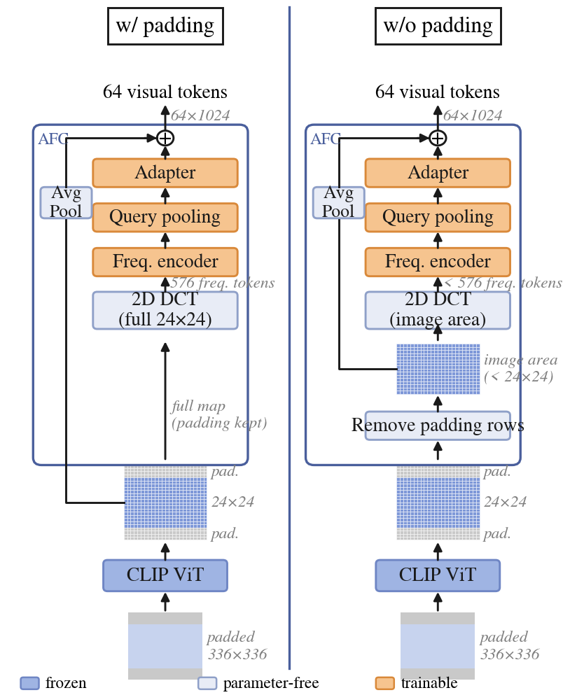

<div align="center">
<h1>AFC</h1>
<h3>Frequency-Domain Visual Token Compression for Vision-Language Models</h3>

Jin Ryu<sup>†</sup>, Gyuwan Choi<sup>†</sup>, Yeejin Lee<sup>:email:</sup>

Seoul National University of Science and Technology

(<sup>†</sup>) equal contribution, (<sup>:email:</sup>) corresponding author

[](LICENSE)&nbsp;
[](https://huggingface.co/liuhaotian/llava-v1.5-7b)&nbsp;

</div>

## News
* **`Oct. 2026`:** We release the code of AFC, with training / evaluation scripts and the baselines (average pooling, Fourier-VLM low-frequency truncation, LLaVA-PruMerge) used in the paper.

## Table of Contents
- [Introduction](#introduction)
- [Results](#results)
- [Getting Started](#getting-started)
- [Code Structure](#code-structure)
- [Contact](#contact)
- [Acknowledgement](#acknowledgement)
- [Citation](#citation)

## Introduction
Vision-language models represent each image with hundreds of visual tokens, which increases the prefill computation and KV-cache memory of the language model. We propose **AFC (Adaptive Fourier Compressor)**, which applies the discrete cosine transform (DCT) to visual features and aggregates **all** frequency components into a compact token set via learnable query pooling, instead of keeping a fixed low-frequency band. AFC has a global (24×24) and a block-wise (16 blocks of 6×6) DCT variant, adds the frequency correction to an average-pooled spatial base, and is trained by knowledge distillation while the vision encoder, projector, and language model stay **frozen** (≈1.2M trainable parameters). Compressing the 576 visual tokens of LLaVA-1.5-7B to 64–256, AFC achieves the best average score among the compared methods at every token budget on six benchmarks; with 64 tokens, AFC-global retains 94.1% of the original performance and outperforms Fourier-VLM-style low-frequency truncation by 5.0%p.

<div align="center"><b>Overall architecture of AFC between the frozen vision encoder and the frozen projector of LLaVA-1.5.</b>

</div>

## Results

> Frozen LLaVA-1.5-7B; all rows measured by us under the same setting. AFC is trained on the LLaVA-1.5 instruction data (544k samples, OCR-VQA and text-only samples excluded). Fourier-VLM denotes its low-frequency truncation applied to the same frozen model (not the paper's numbers, which fine-tune the LLM). PruMerge uses the official implementation with a fixed token budget.

| Model | #Tokens | GQA | SciQA | VQA<sup>T</sup> | POPE | MMB | MMMU | Avg. |
| :--- | :---: | :---: | :---: | :---: | :---: | :---: | :---: | :---: |
| LLaVA-1.5-7B | 576 | 61.9 | 69.6 | 58.2 | 85.9 | 64.3 | 36.7 | 62.8 |
| *Token reduction 55.6%* | | | | | | | | |
| Avg pooling | 256 | 58.3 | 68.0 | 51.8 | 81.7 | 59.4 | **35.7** | 59.1 |
| Fourier-VLM | 256 | 59.6 | **68.8** | 53.4 | 84.1 | 61.6 | 35.3 | 60.5 |
| PruMerge | 256 | 58.6 | 68.3 | **55.2** | **85.1** | 62.8 | 34.7 | 60.8 |
| AFC-block (ours) | 256 | **60.2** | **68.8** | 53.8 | 83.6 | **63.6** | 35.4 | **60.9** |
| AFC-global (ours) | 256 | 60.1 | 68.5 | 54.0 | 83.2 | 63.0 | 35.1 | 60.7 |
| *Token reduction 75.0%* | | | | | | | | |
| Avg pooling | 144 | 57.2 | 67.6 | 49.7 | 81.2 | 56.2 | 35.7 | 57.9 |
| Fourier-VLM | 144 | 56.9 | 69.3 | 50.1 | 81.7 | 58.2 | 36.3 | 58.8 |
| PruMerge | 144 | 57.0 | 69.0 | **55.2** | 81.7 | 61.5 | **36.9** | 60.2 |
| AFC-block (ours) | 144 | 59.8 | 68.4 | 52.7 | 81.9 | **62.6** | 36.3 | 60.3 |
| AFC-global (ours) | 144 | **60.1** | **69.4** | 52.7 | **83.2** | 61.9 | 36.4 | **60.6** |
| *Token reduction 88.9%* | | | | | | | | |
| Avg pooling | 64 | 53.1 | 65.9 | 45.3 | 74.4 | 46.3 | 33.2 | 53.0 |
| Fourier-VLM | 64 | 54.0 | 66.7 | 46.0 | 74.0 | 50.3 | 33.9 | 54.1 |
| PruMerge | 64 | 54.4 | **68.8** | **54.5** | 73.1 | 59.4 | **35.9** | 57.7 |
| AFC-block (ours) | 64 | 57.9 | 67.6 | 50.2 | 81.7 | **60.7** | 35.4 | 58.9 |
| AFC-global (ours) | 64 | **58.3** | 68.5 | 49.4 | **82.5** | 60.2 | 35.6 | **59.1** |

> Ablations (64 tokens, 544k training samples). *w/o padding*: the square padding added by LLaVA-1.5 preprocessing is removed from the CLIP feature map before the DCT.

| Setting | GQA | SciQA | VQA<sup>T</sup> | POPE | MMB | MMMU | Avg. |
| :--- | :---: | :---: | :---: | :---: | :---: | :---: | :---: |
| AFC-global | 58.3 | 68.5 | 49.4 | 82.5 | 60.2 | 35.6 | 59.1 |
| └ w/o KD | 57.8 | 68.1 | 49.0 | 81.8 | 59.9 | 34.6 | 58.5 (−0.6) |
| └ w/o padding | 58.5 | 68.2 | 50.1 | 82.4 | 60.4 | 34.8 | 59.1 (0.0) |
| AFC-block | 57.9 | 67.6 | 50.2 | 81.7 | 60.7 | 35.4 | 58.9 |
| └ w/o padding | 58.8 | 67.7 | 51.2 | 83.1 | 62.0 | 35.3 | 59.7 (+0.8) |

<div align="center"><b>Padding ablation: the DCT is applied to the full feature map (w/ padding) or only to the image area (w/o padding).</b>

</div>

> Theoretical cost (Vicuna-7B, FP16, 64 text tokens assumed; `scripts/afc/complexity.py`). AFC FLOPs are counted with the PyTorch FLOP counter on the trained configuration.

| #Tokens | Visual KV cache | Prefill | Prefill reduction | AFC-global | AFC-block |
| :---: | :---: | :---: | :---: | :---: | :---: |
| 576 | 288 MiB | 8.40 TFLOPs | – | – | – |
| 256 | 128 MiB | 4.17 TFLOPs | 50.3% | 0.64 GFLOPs | 0.52 GFLOPs |
| 144 | 72 MiB | 2.71 TFLOPs | 67.8% | 0.47 GFLOPs | 0.38 GFLOPs |
| 64 | 32 MiB | 1.66 TFLOPs | 80.2% | 0.34 GFLOPs | 0.28 GFLOPs |

## Getting Started

### 1. Environment
```bash
git clone https://github.com/gyuz1/AFC.git
cd AFC
bash scripts/afc/setup_env.sh        # conda env `afc` (transformers 4.37.2, lmms-eval v0.2.0)
source scripts/afc/env.sh            # activates the env and exports AFC_DATA, MODEL, DATA_PATH, ...
```
Data, model weights and third-party code are kept outside the repository in `AFC_DATA` (default `../afc_common/data`).

### 2. Data and model
```bash
python scripts/afc/download_data.py          # benchmarks, tuning splits, llava-v1.5-7b weights
bash scripts/afc/download_llava_train.sh     # LLaVA-1.5 instruction data (~57 GB); writes llava_v1_5_available.json
python scripts/afc/check_data.py             # sanity check of the downloaded files
```

### 3. Training
Each run trains only the compressor (vision encoder, projector, LLM frozen) and writes a normal LLaVA model directory to `checkpoints/llava-v1.5-7b-afc-<run name>/` (`config.json` with a `visual_compressor` entry and `visual_compressor.bin`). The paper runs use the whole training data on two GPUs (DDP, effective batch 24):
```bash
# AFC-global, 64 tokens (configs: global_full.yaml / _144 / _256)
RUN_NAME=global_all EXTRA_CONFIG=configs/afc/global_full.yaml MAX_TRAIN_SAMPLES=all \
TRAIN_GPU=0 TRAIN_GPUS=0,1 EVAL_GPUS="0 1" TARGET_EFFECTIVE_BATCH=24 START_STAGE=train \
    bash scripts/afc/pipeline_main.sh

# AFC-block, 64 tokens (configs: full.yaml / block_full_144.yaml / block_full_256.yaml)
RUN_NAME=block_all EXTRA_CONFIG=configs/afc/full.yaml MAX_TRAIN_SAMPLES=all \
TRAIN_GPU=0 TRAIN_GPUS=0,1 EVAL_GPUS="0 1" TARGET_EFFECTIVE_BATCH=24 START_STAGE=train \
    bash scripts/afc/pipeline_main.sh
```
`pipeline_main.sh` runs train → quick eval → full eval and logs to W&B (`USE_WANDB=0` to disable). Ablations use the same command with `configs/afc/global_nokd.yaml` (w/o KD), `configs/afc/global_valid.yaml` and `configs/afc/block_valid.yaml` (w/o padding). A single run without the pipeline: `GPU=0 bash scripts/afc/train.sh <run name> <config yaml>`.

### 4. Evaluation
```bash
GPU=0 bash scripts/afc/run_eval.sh checkpoints/llava-v1.5-7b-afc-global_all   # GQA, SciQA, TextVQA, POPE, MMB, MMMU
python scripts/afc/plot_budget.py                                              # results table
```

### 5. Baselines (training free, same frozen model)
```bash
python scripts/afc/make_param_free_ckpt.py --mode avgpool --tokens 64        # average pooling
python scripts/afc/make_param_free_ckpt.py --mode fourier_vlm --tokens 64    # Fourier-VLM low-frequency truncation
GPU=0 bash scripts/afc/run_prumerge.sh 64 144 256                             # LLaVA-PruMerge (official code, fixed K)
```

### 6. Tests
```bash
CUDA_VISIBLE_DEVICES= python -m pytest -q tests/afc
```

## Code Structure

| Path | Role |
| :--- | :--- |
| `llava/model/visual_compressor/` | AFC: `dct.py`, `blocks.py`, `positional.py`, `frequency_encoder.py`, `query_pool.py`, `adapter.py`, `compressor.py`, `valid_region.py` (padding removal), `fixed_compressors.py` (baselines), `config.py`, `builder.py` |
| `llava/model/llava_arch.py` | `encode_images`: compressor between the vision tower and the projector |
| `llava/train/train_compressor.py` | training entry point (CE + answer-token KD) |
| `llava/eval/afc/` | evaluation helpers (lmms-eval / LLaVA official scorers) |
| `configs/afc/` | training configurations |
| `scripts/afc/` | setup, data, training, evaluation, figures |
| `tests/afc/` | unit tests |

The original LLaVA README is kept in [`docs/LLaVA_README.md`](docs/LLaVA_README.md).

## Contact
If you have any questions, please contact Gyuwan Choi (gyuwan1@seoultech.ac.kr) or Jin Ryu (ryujin@seoultech.ac.kr).

## Acknowledgement
AFC is built on the following open-source projects: [LLaVA](https://github.com/haotian-liu/LLaVA), [LLaVA-PruMerge](https://github.com/42Shawn/LLaVA-PruMerge), [Fourier-VLM](https://arxiv.org/abs/2508.06038), and [lmms-eval](https://github.com/EvolvingLMMs-Lab/lmms-eval).
This work was supported by the Institute of Information & Communications Technology Planning & Evaluation (IITP) grant funded by the Korea government (MSIT) (No. RS-2026-25548148).

## Citation
If you find AFC useful in your research, please consider giving us a star 🌟 and citing it by the following BibTeX entry.

```bibtex
@misc{afc2026,
  title  = {Frequency-Domain Visual Token Compression for Vision-Language Models},
  author = {Jin Ryu and Gyuwan Choi and Yeejin Lee},
  year   = {2026},
  howpublished = {\url{https://github.com/gyuz1/AFC}}
}
```
